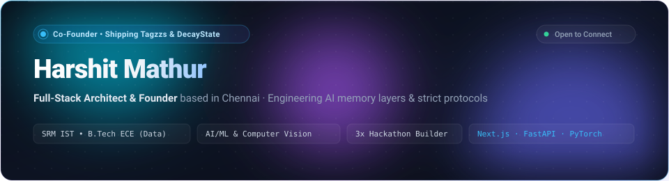
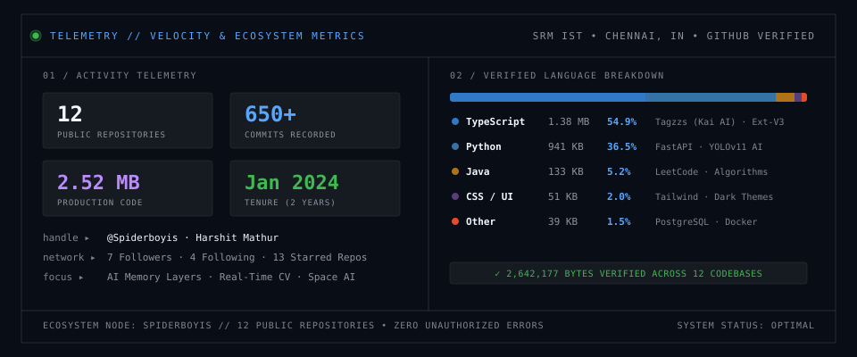

 

  

## ⚡ Builder Dossier

> *"Building product infrastructure end-to-end — from low-level computer vision pipelines to reactive web interfaces — and shipping SaaS between lectures."*

- 🎓 **Academic**: B.Tech in Electronics & Communication Engineering (ECE) with specialization in **Data Sciences** at **SRM Institute of Science and Technology (SRM IST)**, Kattankulathur, Chennai.
- 🚀 **Founder & Builder**: Co-founder of [Tagzzs](https://tagzzs.com) (AI second brain platform) and [DecayState](https://decaystate.com) (strict visual accountability engine).
- 🏆 **Maker Track Record**: 3x Hackathon Builder, Committee Head at AARUUSH (SRMIST), IEEE EDS Member.
- 🔭 **Core Domains**: Full-Stack SaaS Architecture, Applied Computer Vision (OpenCV, YOLOv11, MediaPipe), High-Performance APIs (FastAPI, Flask, Next.js), and Vector-Augmented AI Systems.

  

## 🛠️ Featured Ventures & Research

  

 

### 1. [Tagzzs](https://tagzzs.com) — AI-Powered Second Brain & Knowledge Memory Layer
- **Live Platform**: [tagzzs.com](https://tagzzs.com) • [Chrome Web Store Extension](https://chromewebstore.google.com/detail/bhndpjphbajpienojjebgfcclmogpcol) • [GitHub Repository](https://github.com/Spiderboyis/tagzzs)
- **Role**: Co-Founder & Full-Stack Architect
- **Tech Stack**: `Next.js 16 (App Router)`, `FastAPI`, `Supabase (PostgreSQL, Auth)`, `TypeScript`, `Tailwind CSS`, `ChromaDB`, `Groq (Llama 3)`, `Manifest V3 Extension`
- **Overview**: Stop losing what you already saved. Tagzzs captures articles, code snippets, bookmarks, and workflows via a lightweight browser extension, organizing them with sub-second vector semantic search and contextually resurfacing knowledge directly into ChatGPT, Claude, and Gemini workflows.

---

### 2. [DecayState](https://decaystate.com) — Strict-Accountability Protocol Engine
- **Live Platform**: [decaystate.com](https://decaystate.com) • [Signup Portal](https://www.decaystate.com/signup) • [GitHub Repository](https://github.com/Col-Asy/Decay-State)
- **Role**: Co-Founder & Core Architect
- **Tech Stack**: `Next.js`, `FastAPI`, `Python`, `TypeScript`, `Tailwind CSS`, `Framer Motion`, `Supabase`, `Groq (Llama 3)`, `LangChain`
- **Overview**: Execute 80% of your daily protocol, or physically watch your avatar and ambition decay. Built for people who need high-friction stakes: an uncompromising AI warden vets excuses, visual degradation reflects missed commitments, and missing 3 consecutive days triggers the Ruin State recovery protocol.

---

### 3. [CURL-Vision](https://github.com/Spiderboyis/fitness-tracker) — Real-Time Computer Vision Workout Coach
- **Source Available**: [Spiderboyis/fitness-tracker](https://github.com/Spiderboyis/fitness-tracker)
- **Role**: Lead Developer & Creator
- **Tech Stack**: `Python`, `Google MediaPipe Pose`, `OpenCV`, `Flask`, `Next.js`, `Tailwind CSS`, `Llama LLM`
- **Overview**: Autonomous workout feedback without wearable sensors. Uses Google MediaPipe to track 33 3D skeletal landmarks in real-time, calculating bilateral joint angles to verify exercise form, count repetitions dynamically, provide live biomechanical feedback overlays, and synthesize personalized nutritional plans via Llama LLM.

---

### 4. [Solarflare & CME Detector](https://github.com/Spiderboyis) — Astrophysical Computer Vision with YOLOv11
- **Research Reference**: [SRMIST Space Weather Research](https://github.com/Spiderboyis) • [Portfolio Demo](https://spiderboyis.vercel.app/)
- **Role**: Deep Learning & Computer Vision Researcher (SRMIST ECE Data Sciences)
- **Tech Stack**: `PyTorch`, `Ultralytics YOLOv11`, `OpenCV`, `TorchVision`, `Python`, `NumPy`, `Matplotlib`
- **Overview**: Space weather early warning system custom-trained on high-resolution solar magnetogram and coronagraph feeds. Uses YOLOv11 deep object detection to classify sunspot magnetic topologies (Mount Wilson and Zurich-MacIntosh classification schemes) to predict high-energy solar flare outbreaks and Coronal Mass Ejections (CMEs).

  

## 🧬 Technical Arsenal

| Category | Technologies & Tools |
|---|---|
| **Languages** | `Python`, `TypeScript`, `JavaScript`, `Java`, `C`, `SQL (PostgreSQL)`, `HTML5`, `CSS3` |
| **Frontend & UI** | `Next.js (App Router)`, `React`, `Tailwind CSS`, `Shadcn/ui`, `Framer Motion` |
| **Backend & Microservices** | `FastAPI`, `Flask`, `Node.js`, `Express`, `Next.js API Routes`, `RESTful APIs` |
| **AI / Machine Learning & CV** | `PyTorch`, `Ultralytics YOLOv11`, `OpenCV`, `Google MediaPipe`, `ChromaDB`, `Groq (Llama 3)`, `Hugging Face`, `LangChain`, `Scikit-Learn` |
| **Databases & Cloud** | `Supabase (PostgreSQL, Row Level Security, Auth)`, `Firebase / Firestore`, `Vercel` |
| **DevOps & Engineering Tools** | `Git`, `GitHub Actions (CI/CD)`, `Docker`, `Linux / Bash`, `Postman`, `Jupyter Notebook`, `VS Code` |

  

## 📊 Telemetry & Live Activity

### Contribution Activity (Automated Snake Workflow)

<picture>
  <source media="(prefers-color-scheme: dark)" srcset="https://raw.githubusercontent.com/Spiderboyis/Spiderboyis/output/github-contribution-grid-snake-dark.svg">
  <source media="(prefers-color-scheme: light)" srcset="https://raw.githubusercontent.com/Spiderboyis/Spiderboyis/output/github-contribution-grid-snake.svg">
  
</picture>

  

### Engineering Metrics & Community Velocity

  

### Let's Build Something Exceptional

  <a href="https://spiderboyis.vercel.app/">Portfolio</a> •
  <a href="mailto:harshitmathur88@gmail.com">harshitmathur88@gmail.com</a> •
  <a href="https://linkedin.com/in/harshitmathur03">LinkedIn</a> •
  <a href="https://x.com/spiderboyis">X (@spiderboyis)</a> •
  <a href="https://reddit.com/u/spiderboyis">Reddit (u/spiderboyis)</a> •
  <a href="https://github.com/Spiderboyis">GitHub (@Spiderboyis)</a>

 
Engineered with pure SMIL vector animation • Crafted by Harshit Mathur

